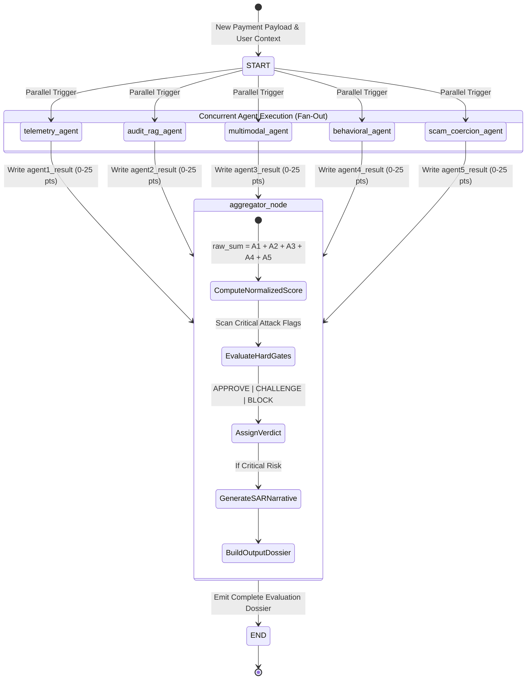
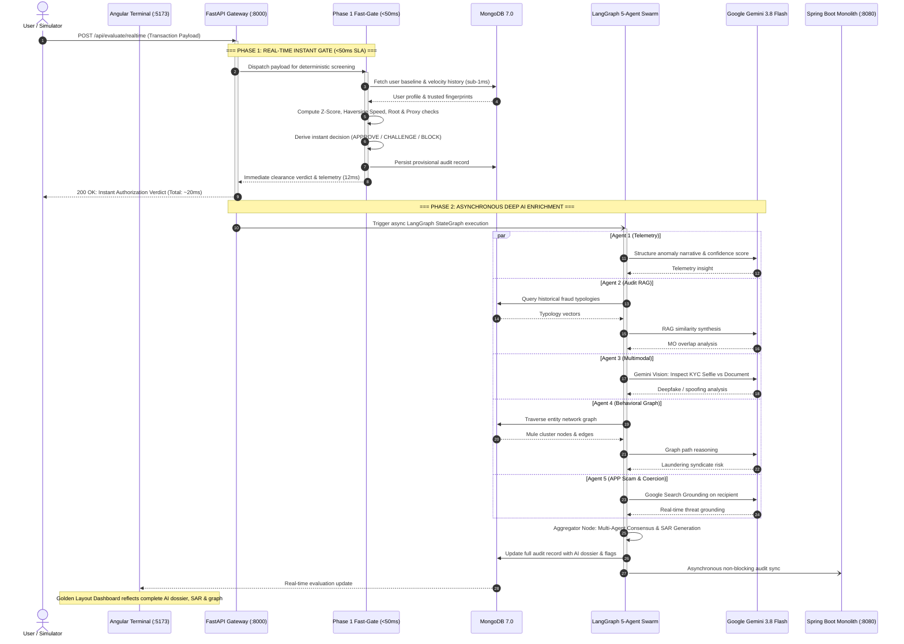

# 🛡️ AegisGuard AI — Multimodal Fraud Intelligence & Autonomous Swarm Platform

[](https://www.python.org/)
[](https://fastapi.tiangolo.com/)
[](https://langchain-ai.github.io/langgraph/)
[](https://ai.google.dev/)
[](https://angular.dev/)
[](https://golden-layout.com/)
[](https://spring.io/projects/spring-boot)
[](https://www.mongodb.com/)
[](https://cloud.google.com/run)
[](#)

---

## 📌 Executive Overview

**AegisGuard AI** is an enterprise-grade, pre-settlement fraud prevention and Anti-Money Laundering (AML) intelligence system. Engineered for high-throughput, latency-critical banking and fintech payment rails, AegisGuard unifies deterministic telemetry screening with an autonomous **5-Agent LangGraph Swarm** powered by **Google Gemini AI**.

It introduces a **Two-Phase Pre-Settlement Hybrid Architecture**:
1. **Phase 1: Real-Time Instant Gate (`<50ms` SLA)** — Immediate deterministic risk evaluation across all threat vectors with zero external API dependencies, permitting or halting transactions before ledger clearance.
2. **Phase 2: Asynchronous Deep Multimodal Reasoning** — Autonomous agent swarm execution performing deep visual biometric verification, graph syndicate traversal, historical RAG audit similarity analysis, Authorized Push Payment (APP) coercion detection with Google Search Grounding, and regulatory **FinCEN Suspicious Activity Report (SAR)** narrative synthesis.

---

## 🏛️ Comprehensive System Architecture & Engineering Topology

AegisGuard AI implements a multi-tier, event-driven banking architecture tailored for ultra-low latency pre-settlement decisioning, autonomous multi-agent consensus, and high-assurance regulatory auditing.

### 1. Master End-to-End System Topology

```mermaid
flowchart TB
    %% =========================================================================
    %% TIER 1: CLIENT PRESENTATION & INGESTION
    %% =========================================================================
    subgraph Tier1["1. PRESENTATION & WORKSTATION TIER"]
        direction LR
        subgraph TerminalUI["Angular 21 Golden-Layout Console (Port 5173)"]
            DASH_ROOT["Angular Root & Layout Engine"]
            DOCK_ENG["Golden Layout 2.6 Virtual Grid Manager"]
            POPOUT_ENG["Multi-Monitor Popout Window Broker"]
            PANELS["16 Modular Workstation Panels:\n• Decision Verdict • Telemetry Agent • Audit RAG\n• Multimodal Identity • Behavioral Graph • APP Coercion\n• Interactive Force Network Graph • Live Audit Trail\n• SAR Compliance Dossier • Risk Profile Radar"]
        end

        subgraph SimUI["Threat Studio & Mobile Sandbox (Port 5174)"]
            PRESETS["1-Click Threat Injector (7 Pre-configured Attack Vectors)"]
            PHONE_SIM["Interactive Smartphone Emulator (Live Victim View)"]
            DEBIAS_UI["AI De-Biasing Interactive Victim Chatbot Frame"]
            STEPUP_UI["Dynamic OTP / Biometric Verification Challenge Keypad"]
        end

        subgraph CoreRails["External Payment Ingestion Rails"]
            POS_API["POS Terminals / Payment Gateways / Core Banking REST"]
        end
    end

    %% =========================================================================
    %% TIER 2: API GATEWAY & ROUTING LAYER
    %% =========================================================================
    subgraph Tier2["2. HIGH-THROUGHPUT API GATEWAY & ROUTING TIER (FastAPI : Port 8000)"]
        direction TB
        GATEWAY["FastAPI Application Gateway & Route Broker"]
        VITE_PROXY["Vite Development Reverse Proxy (/api -> :8000)"]
        STATIC_SRV["Static Production Asset Server (Angular Dist + Simulator Dist)"]
        HEALTH_ENG["Liveness & Readiness Health Probes (/health, /api/system-health)"]
        STORE_SYNC["In-Memory Focal Transaction Sync Store (Cross-Port Sync)"]
    end

    %% =========================================================================
    %% TIER 3: TWO-PHASE PRE-SETTLEMENT ENGINE & RESILIENCE
    %% =========================================================================
    subgraph Tier3["3. TWO-PHASE PRE-SETTLEMENT & RESILIENCE CONTROLLER"]
        direction TB
        subgraph Phase1Gate["Phase 1: Real-Time Instant Gate (<50ms SLA)"]
            P1_CTRL["In-Memory Heuristic Pipeline"]
            P1_DEV["Hardware Fingerprint & Root Detection"]
            P1_GEO["Haversine Impossible Speed Matrix"]
            P1_Z["Spending Z-Score Anomaly Evaluator"]
            P1_DEC["Immediate Payment Clearance / Pre-Settlement Hold"]
        end

        subgraph ResilienceTier["Gemini Circuit Breaker Engine"]
            CB_CORE["Thread-Safe State Machine (CLOSED / OPEN / HALF-OPEN)"]
            CB_PROBE["Automated Quota & 429 Interceptor (300s Cooldown)"]
            CB_FALLBACK["Sub-1ms High-Fidelity Deterministic Fallback Engine"]
        end
    end

    %% =========================================================================
    %% TIER 4: LANGGRAPH AUTONOMOUS MULTI-AGENT SWARM
    %% =========================================================================
    subgraph Tier4["4. LANGGRAPH 5-AGENT PARALLEL REASONING SWARM"]
        direction TB
        LG_START(["START: Initial FraudDetectionState"])

        subgraph Agent1["Agent 1: Telemetry & Velocity (0-25 Pts)"]
            A1_DET["Z-Score Deviation • Haversine km/h • 1-Hour Rolling Velocity Cache • Root/VPN"]
            A1_AI["Gemini Anomaly Contextualization & Signal Confidence Scoring"]
        end

        subgraph Agent2["Agent 2: Audit & Database RAG (0-25 Pts)"]
            A2_DET["24h MPIN/Password Reset • Login Streak Tracking • Account Age"]
            A2_RAG["Cosine Overlap RAG Vector Match over MongoDB Fraud Typologies"]
            A2_AI["Gemini Typology Modus Operandi Synthesis"]
        end

        subgraph Agent3["Agent 3: Multimodal Identity & Biometrics (0-25 Pts)"]
            A3_DET["Biometric Bypass Flags • Glare/Blur Heuristics • OCR Discrepancy"]
            A3_VISION["Google Gemini Vision Multimodal Inspection:\n• Anti-Spoof Screen Replay • Synthetic Deepfake • Doc Tampering"]
        end

        subgraph Agent4["Agent 4: Behavioral & Graph Anomaly (0-25 Pts)"]
            A4_DET["Mule Syndicate Hub Linkage • Degree Centrality • Circadian Hours • Balance Drain"]
            A4_AI["Gemini Graph Traversal & Money-Laundering Syndicate Reasoning"]
        end

        subgraph Agent5["Agent 5: Scam Narrative & Coercion (0-25 Pts)"]
            A5_DET["Urgency Memo Regex Lexicon • Active Call Telemetry • Clipboard Dwell (<2s)"]
            A5_SEARCH["Google Search Grounding: Live Web Verification of Beneficiary Entities"]
            A5_DEBIAS["Conversational Victim De-Biasing Copilot (/api/debias-chat)"]
        end

        LG_AGG["Policy Aggregator & Consensus Engine Node"]
        LG_END(["END: Final Evaluation Dossier"])
    end

    %% =========================================================================
    %% TIER 5: POLICY CONSENSUS & COMPLIANCE ENGINE
    %% =========================================================================
    subgraph Tier5["5. POLICY CONSENSUS & REGULATORY COMPLIANCE TIER"]
        direction TB
        NORM_ENG["Score Normalizer: (Raw Sum / 125) * 100 -> 0-100 Unified Scale"]
        HARD_TRIGGERS{"Critical Hard-Trigger Check:\n• Deepfake Confirmed?\n• Impossible Travel + Rooted Device?\n• Sanctioned Mule Ring?"}
        
        DEC_APPROVE["🟢 APPROVE (Score 0-24)\nAuto-Clear to Payment Network"]
        DEC_CHALLENGE["🟡 CHALLENGE (Score 25-59 or Coercion)\nTrigger Step-Up MFA or AI De-Biasing"]
        DEC_BLOCK["🔴 BLOCK (Score 60-100 or Critical Attack)\nHalt Transfer, Freeze Account, Flag Alert"]

        SAR_ENG["FinCEN SAR Legal Engine: Automated BSA Suspicious Activity Narrative Synthesis"]
    end

    %% =========================================================================
    %% TIER 6: ENTERPRISE DATA & MONOLITH COMPANION
    %% =========================================================================
    subgraph Tier6["6. ENTERPRISE DATA PLANE & AUDIT MONOLITH"]
        direction LR
        subgraph MongoCluster["MongoDB 7.0 Master Database (fraud_detection_db)"]
            COL_USERS[("user_accounts\n• KYC Identity Cards\n• Trusted Fingerprints\n• Financial Baselines")]
            COL_AUDIT[("transaction_audits\n• Immutable Audit Trails\n• Agent Contribution Logs\n• Resolution History")]
            COL_TYP[("fraud_typologies\n• Modus Operandi Embeddings\n• Historical Vector Index")]
            COL_GRAPH[("network_nodes & edges\n• Entity Relationships\n• Mule Syndicate Graph")]
        end

        subgraph SpringMonolith["Spring Boot 3.2 Monolith (Port 8080)"]
            SB_CTRL["Transaction & User REST API Controllers"]
            SB_LOADER["Bootstrap Data Loader (Seed Accounts, Typologies, Graph)"]
            SB_AUDIT["Audit & Step-Up MFA Verification Handler"]
            SB_CB["Circuit Breaker Probe Cache (30s Non-blocking Health Check)"]
        end
    end

    %% =========================================================================
    %% TIER 7: EXTERNAL GOOGLE CLOUD AI PLATFORM
    %% =========================================================================
    subgraph Tier7["7. GOOGLE CLOUD AI ECOSYSTEM"]
        direction TB
        GEMINI_CORE["Google Gemini 3.8 Flash (Pydantic Structured Output)"]
        GEMINI_VISION["Google Gemini Multimodal Vision API (KYC Verification)"]
        GOOGLE_SEARCH["Google Search Grounding Tool (Live Threat Advisories)"]
        VERTEX_LAYER["Google Cloud Run / Vertex AI Banking VPC Controls"]
    end

    %% -------------------------------------------------------------------------
    %% CONNECTION FLOWS
    %% -------------------------------------------------------------------------
    %% Workstations to Gateway
    TerminalUI -->|"/api (Vite Proxy :5173)"| GATEWAY
    SimUI -->|"/api (Vite Proxy :5174)"| GATEWAY
    CoreRails -->|"POST /api/evaluate/realtime"| GATEWAY

    %% Gateway to Phase 1 & Circuit Breaker
    GATEWAY -->|"Phase 1 Dispatch"| P1_CTRL
    P1_CTRL --> P1_DEV & P1_GEO & P1_Z --> P1_DEC
    P1_DEC -.->|"Instant Settlement Decision (<50ms)"| CoreRails

    GATEWAY -->|"Phase 2 Dispatch"| CB_CORE
    CB_CORE -->|"Healthy (CLOSED)"| LG_START
    CB_CORE -->|"Tripped (OPEN)"| CB_FALLBACK --> LG_AGG

    %% LangGraph Parallel DAG
    LG_START --> Agent1 & Agent2 & Agent3 & Agent4 & Agent5
    Agent1 & Agent2 & Agent3 & Agent4 & Agent5 --> LG_AGG
    LG_AGG --> LG_END

    %% Agent External Google AI Connections
    A1_AI -.-> GEMINI_CORE
    A2_AI -.-> GEMINI_CORE
    A3_VISION -.-> GEMINI_VISION
    A4_AI -.-> GEMINI_CORE
    A5_SEARCH -.-> GOOGLE_SEARCH
    A5_DEBIAS -.-> GEMINI_CORE

    %% Aggregator to Policy Matrix
    LG_END --> NORM_ENG --> HARD_TRIGGERS
    HARD_TRIGGERS -->|"Normal Score < 25"| DEC_APPROVE
    HARD_TRIGGERS -->|"Score 25-59 or Coercion"| DEC_CHALLENGE
    HARD_TRIGGERS -->|"Score >= 60 or Hard Trigger"| DEC_BLOCK
    DEC_BLOCK --> SAR_ENG

    %% Data Plane Integrations
    P1_CTRL -.->|"Direct Read (<1ms)"| COL_USERS
    Agent2 -.->|"Direct Typology Query"| COL_TYP
    Agent4 -.->|"Direct Topology Graph Fetch"| COL_GRAPH
    LG_AGG -->|"Save Complete Audit Record"| COL_AUDIT
    LG_AGG -.->|"Non-Blocking Async Sync"| SB_AUDIT
    SB_AUDIT --> MongoCluster
    CB_PROBE -.->|"Probe Health"| SB_CB

    %% Real-time Broadcast back to UI
    LG_END --> STORE_SYNC
    STORE_SYNC -.->|"Live Polling / State Mirror"| TerminalUI & SimUI
```



---

### 2. LangGraph StateGraph Execution Flow (DAG)

The AI swarm is compiled as an asynchronous StateGraph where all 5 specialized agents execute in parallel across independent threads, followed by an atomic Aggregator node that synthesizes the final consensus:



---

### 3. Two-Phase Pre-Settlement Latency & SLA Pipeline

This diagram shows how AegisGuard fulfills the sub-50ms core banking authorization SLA while asynchronously leveraging deep generative AI reasoning:



---

### 4. Component & Network Port Communication Matrix

| Source Component | Destination Component | Protocol / Port | Latency SLA | Resilience / Fallback Mechanism |
|---|---|---|---|---|
| **Angular Dashboard** (`:5173`) | **FastAPI Gateway** (`:8000`) | HTTP/REST via Vite Reverse Proxy | `<10ms` | Local state caching & reconnect polling |
| **Threat Studio** (`:5174`) | **FastAPI Gateway** (`:8000`) | HTTP/REST via Vite Reverse Proxy | `<10ms` | Direct payload replay from memory |
| **FastAPI Gateway** (`:8000`) | **Phase 1 Fast-Gate** | Internal async function call | `<5ms` | In-memory execution; zero external dependencies |
| **FastAPI Gateway** (`:8000`) | **MongoDB Master** (`:27017`) | PyMongo TCP Socket | `<2ms` | Server selection timeout: `500ms`, fallback to memory cache |
| **LangGraph Swarm** (`:8000`) | **Google Gemini AI API** | HTTPS / TLS 1.3 (Google GenAI SDK) | `~350ms` | **Gemini Circuit Breaker**: Instant failover to deterministic heuristics |
| **LangGraph Swarm** (`:8000`) | **Google Search Grounding** | HTTPS / TLS 1.3 (`types.GoogleSearch()`) | `~450ms` | Bypasses search, applies local high-urgency regex lexicon |
| **FastAPI Gateway** (`:8000`) | **Spring Boot Monolith** (`:8080`)| HTTP REST (`/api/audit`) | `~15ms` | 30s non-blocking circuit breaker probe cache; offline Spring Boot never delays transactions |

---

## 🤖 The 5-Agent LangGraph Swarm

Each agent analyzes dedicated signal surfaces, scores up to **25 risk points**, and provides structured explanations. The Aggregator normalizes total points onto a **0–100 scale** and applies hard policy gates:

| Agent | Focus Area | Deterministic Signals | Gemini AI Augmentation |
|---|---|---|---|
| **Agent 1: Telemetry & Velocity** | Device integrity, network trust, and physical movement | • Amount Z-score deviation<br>• Haversine speed (`>800 km/h` = impossible travel)<br>• Rooted / jailbroken OS, VPN / Tor IP | Anomaly summary and deterministic signal confidence rating |
| **Agent 2: Audit & Database RAG** | Historical account integrity and past fraud typologies | • Recent MPIN / password reset within 24h<br>• Consecutive failed login attempts<br>• Cosine-like text overlap on known MOs | Retrieval-Augmented Generation (RAG) synthesis across historical audit vectors |
| **Agent 3: Multimodal Identity** | Visual KYC, liveness, and synthetic identity defense | • Biometric bypass detection<br>• Glare / blur / resolution heuristics<br>• OCR document discrepancy | **Gemini Vision** inspection for screen replay, synthetic face masks, and document tampering |
| **Agent 4: Behavioral & Graph Anomaly** | Entity relationships and financial habits | • Graph hops to flagged mule hubs<br>• High degree centrality links<br>• Circadian spending (3 AM activity)<br>• High balance drain (`>75%`) | Graph relationship narrative and money-laundering syndicate reasoning |
| **Agent 5: Scam Narrative & Coercion** | Social engineering, Authorized Push Payment (APP) scams | • Coercive memo lexicons (Safe Vault, FBI hold)<br>• Active concurrent call (`>15 min`)<br>• Clipboard dwell time (`<2 sec`) | **Google Search Grounding** on recipient account names and crypto investment promises |

### Decision & Policy Engine

* 🟢 **APPROVE (`Score 0 - 24`)**: Low risk across all vectors. Direct dispatch to payment clearing rail.
* 🟡 **CHALLENGE (`Score 25 - 59` or Coercion Triggers)**: Elevated risk. Suspends funds and deploys:
  * **Step-Up Authentication**: Dynamic OTP or biometric liveness re-verification.
  * **AI De-Biasing Interview**: Conversational mobile intervention agent that walks coerced victims through scam indicators.
* 🔴 **BLOCK (`Score 60 - 100` or Critical Hard Gate)**: Immediate fund freeze and account lock. Triggers:
  * Critical hard triggers: Impossible travel + Rooted device, Confirmed Deepfake, Sanctioned entity, or Mule cluster transfer.
  * Automated **FinCEN SAR** compliance dossier compilation.

---

## ⚡ Two-Phase Pre-Settlement Hybrid Flow

```
Payment Initiation (Simulator / POS / Mobile API)
       │
       ▼
[ PHASE 1: Real-Time Gate ] ─── <50ms SLA ───►  Immediate Clearance / Hold Decision
       │                                         (Zero external API lag, pure deterministic)
       ▼
[ PHASE 2: Deep AI Swarm ]  ─── Background ───►  • Gemini Multimodal Analysis
                                                 • Graph Topology Traversal
                                                 • FinCEN SAR Narrative Generation
                                                 • Live Audit Persisted to MongoDB
```

---

## 🛡️ Gemini Circuit Breaker Engine

To protect live payments against external LLM outages, rate limits (HTTP 429 Quota Exhaustion), or network degradation:

* **Thread-Safe States**: `CLOSED` (Normal), `OPEN` (Fallback engaged), `HALF_OPEN` (Probe).
* **Instant Fallback**: If Gemini is rate-limited or unavailable, the system switches to deterministic fallback heuristics in `<1ms` without throwing errors or dropping transactions.
* **Self-Healing**: Automatically tests endpoint viability after cooldown and resets when quota replenishes.
* **Control Endpoints**: Check state via `GET /api/circuit-breaker` or manually reset via `POST /api/circuit-breaker/reset`.

---

## 📁 Repository Layout

```
builder-cup/
├── python_orchestrator/              # 🐍 Active Production Backend (Python 3.11 / FastAPI)
│   ├── agents/                       # Autonomous LangGraph Agent Implementations
│   │   ├── agent1_telemetry.py       # Telemetry, Z-Score, Haversine Velocity
│   │   ├── agent2_audit_rag.py       # MongoDB Audit RAG & Vector Similarity
│   │   ├── agent3_multimodal.py      # Gemini Vision Biometrics & Deepfake Detection
│   │   ├── agent4_behavioral_graph.py# Graph Analytics & Mule Ring Traversal
│   │   └── agent5_scam_coercion.py   # APP Scam, Coercion & Google Search Grounding
│   ├── graph/                        # LangGraph StateGraph Architecture
│   │   ├── orchestrator_graph.py     # Parallel 5-Agent DAG & Aggregator Node
│   │   └── state.py                  # TypedDict State Schemas & Pydantic Definitions
│   ├── circuit_breaker.py            # Quota-Aware Resilient Circuit Breaker
│   ├── db_client.py                  # High-speed PyMongo client & Spring Boot bridge
│   ├── orchestrator.py               # Two-Phase Evaluation Controllers
│   ├── main.py                       # FastAPI API server, Scenarios & Static Handlers
│   ├── requirements.txt              # Python dependency manifest
│   └── tests/                        # Agent unit & integration test suites
│
├── src/                              # 🅰️ Main Terminal Dashboard (Angular 21 + Golden Layout)
│   ├── app/
│   │   ├── modals/                   # Architecture, Step-Up Challenge, SAR Export Modals
│   │   ├── panels/                   # 16 Golden Layout Workstation Panels
│   │   │   ├── decision-verdict-panel.component.ts
│   │   │   ├── telemetry-agent-panel.component.ts
│   │   │   ├── audit-rag-agent-panel.component.ts
│   │   │   ├── verification-agent-panel.component.ts
│   │   │   ├── behavioral-graph-agent-panel.component.ts
│   │   │   ├── scam-coercion-agent-panel.component.ts
│   │   │   ├── network-graph-panel.component.ts
│   │   │   └── mobile-simulator-panel.component.ts
│   │   └── services/                 # Golden Layout & Live Web Socket / Data Services
│   └── styles.css / index.css        # Cyberpunk / Fintech Dark-Mode Design System
│
├── simulator/                        # 📱 Threat Studio & Mobile Simulator (Vite + React)
│   ├── index.html                    # Interactive Mobile Device Frame & Preset Injector
│   ├── simulator.js                  # Threat Payload Dispatcher & De-Biasing Chat Client
│   └── simulator.css                 # Mobile UI & Threat Studio Styling
│
├── spring-boot-transaction-audit/    # ☕ Transaction Core Monolith (Java 17 / Spring Boot 3.2)
│   ├── pom.xml                       # Maven Configuration (Spring Data MongoDB)
│   └── src/main/java/com/aegisguard/ # Controllers, Repositories, Seed Data Loader
│
├── public/                           # Static Assets (Logos, Biometric reference images)
├── Dockerfile                        # Multi-Stage Production Container (Node + Python)
├── docker-compose.yml                # Full-Stack Local Deployment (App + MongoDB)
├── cloudbuild.yaml                   # Google Cloud Build CI/CD Pipeline
├── deploy-cloudrun.ps1 / .sh         # Automated Google Cloud Run Deployers
├── start.bat / start.ps1             # 1-Click Local Developer Launchers
├── test_system.py                    # End-to-End System Verification Script
├── package.json                      # Node workspace & compilation scripts
└── vite.config.js                    # Vite dev server & proxy configurations
```

---

## 🚀 Quick Start Guide

### Prerequisites

* **Node.js**: `v20+` & `npm`
* **Python**: `3.11+`
* **Java** *(Optional for Monolith)*: OpenJDK `17+`
* **MongoDB**: Local MongoDB instance or free [MongoDB Atlas](https://www.mongodb.com/cloud/atlas) cluster
* **Google Gemini API Key** *(Optional)*: Get one at [Google AI Studio](https://aistudio.google.com/). *If omitted, the built-in deterministic fallback engine runs automatically.*

---

### 1. Environment Configuration

Copy the sample environment file and configure your credentials:

```bash
cp .env.example .env
```

Edit `.env`:
```ini
# Port Configuration
PORT=8080
HOST=0.0.0.0

# Google Gemini AI Key (Powers Agents 2, 3, 5)
# If blank, deterministic fallback runs with zero disruption
GEMINI_API_KEY=your_gemini_api_key_here

# MongoDB Connection String
MONGO_URI=mongodb://localhost:27017/fraud_detection_db

# Spring Boot Monolith Companion URL (Optional)
SPRING_BOOT_URL=http://localhost:8080
```

---

### 2. Launching Locally

#### Method A: 1-Click Launcher (Windows)
Double-click `start.bat` or run in PowerShell:
```powershell
./start.ps1
```

#### Method B: npm Scripts
Install dependencies and run all services concurrently:
```bash
# 1. Install Node dependencies
npm install

# 2. Install Python orchestrator dependencies
pip install -r python_orchestrator/requirements.txt

# 3. Launch Python Orchestrator, Main Terminal, and Threat Studio
npm run dev
```

*To also launch the Spring Boot monolith alongside the stack:*
```bash
npm run dev:all
```

#### Method C: Docker Compose (Full Stack + MongoDB)
Spin up the entire application container alongside MongoDB with a single command:
```bash
docker compose up --build
```

---

### 3. Service & Port Matrix

| Service | Port | URL | Description |
|---|---|---|---|
| **Main Golden-Layout Terminal** | `5173` | [http://localhost:5173](http://localhost:5173) | Primary SOC analyst dashboard with draggable, dockable multi-window workspace |
| **Threat Studio & Mobile Simulator**| `5174` | [http://localhost:5174](http://localhost:5174) | Interactive mobile device emulator with 1-click attack scenario injection |
| **Python LangGraph Orchestrator** | `8000` | [http://127.0.0.1:8000](http://127.0.0.1:8000) | FastAPI REST backend, LangGraph swarm, and AI evaluation engine |
| **Interactive API Docs (Swagger)** | `8000` | [http://127.0.0.1:8000/docs](http://127.0.0.1:8000/docs) | OpenAPI interactive schema documentation |
| **Spring Boot Monolith (Optional)** | `8080` | [http://localhost:8080](http://localhost:8080) | Java transaction ledger & audit repository |
| **MongoDB Database** | `27017`| `mongodb://localhost:27017` | Persistent storage for users, audits, typologies, and graph edges |

---

## 🎯 Predefined Threat Scenarios

The platform includes 7 pre-built attack vectors accessible via 1-click in the Threat Studio (`Port 5174`) or through `/api/scenarios`:

1. **🟢 Legitimate Coffee Purchase**: Trusted iPhone in Taipei, matching live selfie, normal amount ($5.50) ➔ **APPROVE**
2. **🔴 Impossible Geo-Travel Jump**: Transaction originates in London 25 mins after Taipei activity (9,500 km at 22,800 km/h), emulator, VPN proxy ➔ **BLOCK**
3. **🔴 Account Takeover & Mule Ring Syphon**: MPIN reset 2 hours prior, 5 failed logins, $32,000 sent to flagged Mule Aggregator #99 with 75% balance drain ➔ **BLOCK**
4. **🔴 Deepfake Presentation Attack**: Synthetic screen replay during KYC selfie capture, tampered document font ➔ **BLOCK**
5. **🟡 High-Value New Beneficiary at 3 AM**: $8,500 wire to unverified recipient during circadian sleep hours ➔ **CHALLENGE (Step-Up OTP)**
6. **🚨 Federal Police "Safe Haven" Scam**: Victim coerced over active 18-minute phone call to wire funds to an imposter safe vault ➔ **CHALLENGE (AI De-Biasing Interview)**
7. **🚨 Pig Butchering Crypto Syndicate**: Coerced transfer to unverified crypto liquidity pool with promise of 450% ROI ➔ **CHALLENGE (AI De-Biasing Interview)**

---

## 🧪 Testing & Verification

### 1. Run the Full System Integration Test
Verifies Spring Boot, Python Orchestrator, all 5 Agents, MongoDB persistence, and Step-Up challenge verification:
```bash
python test_system.py
```

### 2. Benchmark Two-Phase Evaluation & Latency SLAs
Measures Phase 1 instant gate speed (`<50ms` SLA) and tests the entire 7-scenario matrix:
```bash
python python_orchestrator/test_hybrid_evaluation.py
```

### 3. Run Pytest Suite
```bash
pytest python_orchestrator/tests/
```

---

## 🌐 Production Cloud Run Deployment

AegisGuard includes a containerized multi-stage Docker build optimized for **Google Cloud Run**:

* **Stage 1 (Node 20 Alpine)**: Compiles Angular Golden Layout terminal & Threat Studio assets.
* **Stage 2 (Python 3.11 Slim)**: Packages FastAPI, LangGraph, and Uvicorn runtime running under a secure non-root `appuser`.

### One-Click Cloud Run Deployer

#### On Windows (PowerShell):
```powershell
./deploy-cloudrun.ps1 -ProjectId "your-gcp-project-id" -Region "us-central1"
```

#### On Linux / macOS / Cloud Shell:
```bash
chmod +x deploy-cloudrun.sh
./deploy-cloudrun.sh
```

#### Automated Google Cloud Build:
```bash
gcloud builds submit --config=cloudbuild.yaml
```

---

## 📡 API Reference Overview

| Endpoint | Method | Description |
|---|---|---|
| `/api/evaluate/realtime` | `POST` | **Phase 1 Instant Gate**: High-speed (`<50ms`) pre-settlement evaluation |
| `/api/evaluate` | `POST` | **Phase 2 Full Orchestration**: LangGraph 5-agent parallel evaluation |
| `/api/latest-evaluation` | `GET` | Fetches the latest evaluation dossier for cross-port real-time syncing |
| `/api/challenge/verify` | `POST` | Resolves step-up challenge via OTP or biometric confirmation |
| `/api/generate-sar` | `POST` | Synthesizes a FinCEN Suspicious Activity Report (SAR) narrative |
| `/api/debias-chat` | `POST` | Conversational victim intervention agent for APP scam debiasing |
| `/api/circuit-breaker` | `GET` | Reports Gemini circuit breaker status (`CLOSED`, `OPEN`, `cooldown`) |
| `/api/circuit-breaker/reset` | `POST` | Resets tripped circuit breaker back to `CLOSED` |
| `/api/graph` | `GET` | Returns financial network topology nodes and edges |
| `/api/audit-logs` | `GET` | Retrieves persisted transaction audit logs from MongoDB |
| `/api/system-health` | `GET` | Returns operational health across MongoDB, Gemini, and Spring Boot |
| `/health` | `GET` | Kubernetes / Cloud Run container liveness probe |

---

## 🔒 Compliance & Standards

* **FinCEN BSA / AML Compliance**: Automated SAR XML/narrative generation compliant with suspicious activity reporting guidelines.
* **NIST SP 800-63B**: Step-up dynamic multi-factor authentication (MFA) challenge escalation.
* **Principle of Least Privilege**: Production container executes as an unprivileged non-root user (`appuser:1001`).
* **Zero Disruption Guarantee**: Resilient fallback engine ensures payment processing continues uninterrupted even during AI API outages or rate limits.

---

## 👥 Authors & Recognition

Crafted for high-performance financial defense during the **Builder Cup Hackathon**. Engineered with Google Cloud Run, LangGraph, Angular, and Google Gemini AI.
